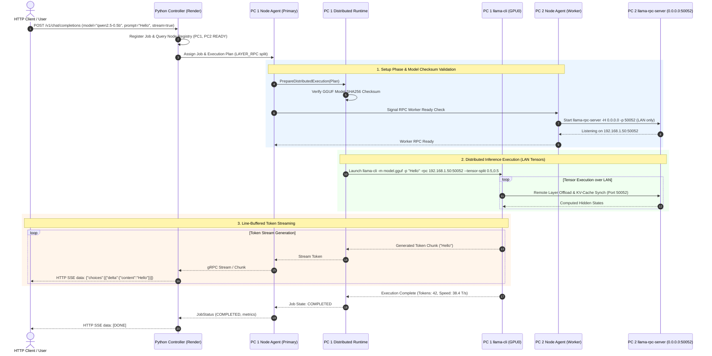

# Execution Flow & Request Lifecycle

**System:** Distributed AI Infrastructure  
**Document:** End-to-End Inference Trace (`EXECUTION_FLOW.md`)  

---

## 1. Complete Inference Lifecycle Trace

```text
1. Client HTTP POST Request (/v1/chat/completions)
        │
        ▼
2. Controller Job Queue & Scheduler (app/scheduler)
        │
        ▼
3. Execution Planner Invoked (pkg/execution)
   (Evaluates node VRAM budgets, scoring, LAN IPs)
        │
        ▼
4. Target Nodes Selected (PC1 Primary + PC2 RPC Worker)
        │
        ▼
5. Model SHA256 Checksum Verification & Load (pkg/model)
        │
        ▼
6. Distributed Runtime Prepared (pkg/runtime)
   - PC2 starts llama-rpc-server on 0.0.0.0:50052
   - PC1 starts llama-cli with -rpc 192.168.1.50:50052 --tensor-split 0.5,0.5
        │
        ▼
7. Distributed Tensor Execution (Local LAN Ethernet)
        │
        ▼
8. Line-Buffered Token Streaming (pkg/llama/process.go)
        │
        ▼
9. Response Streamed Back to Client (OpenAI Server-Sent Events format)
```

---

## 2. Mermaid Sequence Diagram



---

## 3. Detailed Component Interaction Breakdown

| Step | Action | Executing Component | Source File / Handler |
| :--- | :--- | :--- | :--- |
| **1. Request Entry** | HTTP POST `/v1/chat/completions` | Python Controller | `cluster-controller/app/api/cluster.py` |
| **2. Job Scheduling** | Query active nodes, compute VRAM capacity | Controller Scheduler | `cluster-controller/app/scheduler/scorer.py` |
| **3. Plan Calculation** | Calculate `SINGLE_NODE` vs `LAYER_RPC` split ratio | Distributed Planner | `distributed-runtime/pkg/execution/plan.go` |
| **4. Security Validation** | Verify node IP belongs to private CIDR | LAN Security Guard | `distributed-runtime/pkg/communication/security.go` |
| **5. Model Verification** | Compute SHA256 checksum against manifest | Model Manager | `distributed-runtime/pkg/model/loader.go` |
| **6. RPC Startup** | Bind `llama-rpc-server` to LAN interface | RPC Supervisor | `distributed-runtime/pkg/llama/rpc.go` |
| **7. Engine Invocation** | Launch `llama-cli` process with `-rpc` flags | Process Supervisor | `distributed-runtime/pkg/llama/process.go` |
| **8. Token Streaming** | Line-buffer stdout, callback each token | Llama Manager | `distributed-runtime/pkg/llama/process.go` |
