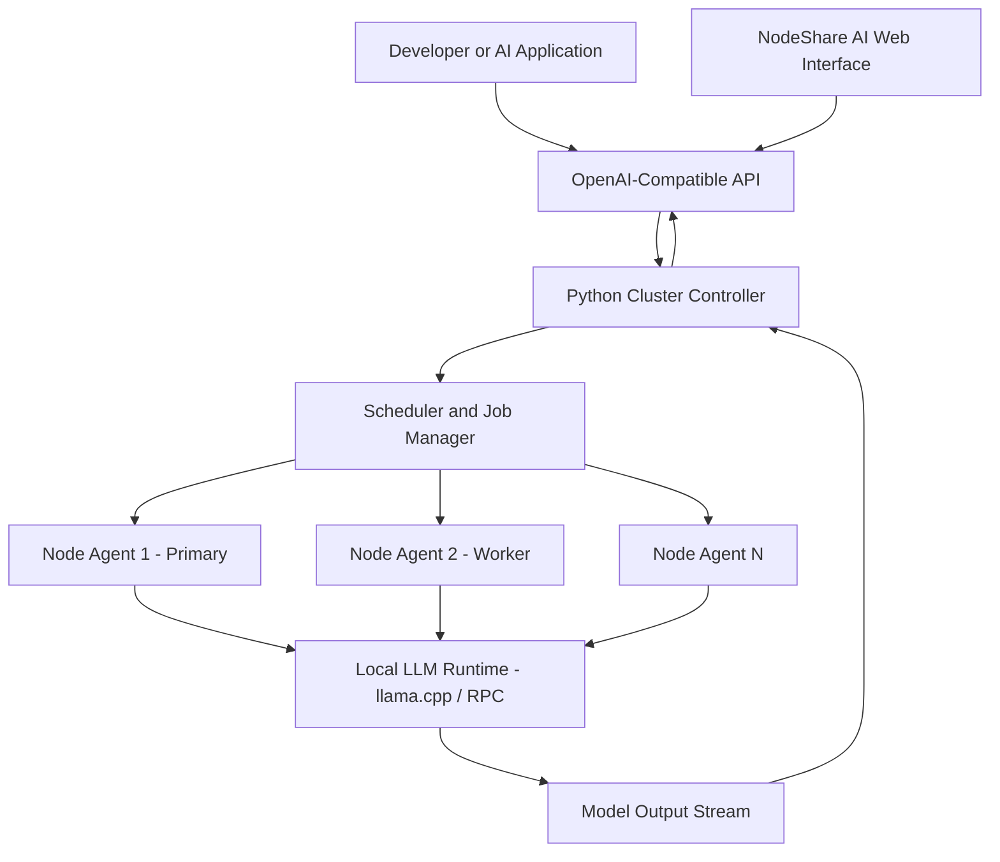

# NodeShare AI 🚀
### Distributed AI Inference Across Your Own Computers

**NodeShare AI** is an experimental distributed AI compute platform designed to connect heterogeneous personal computers through a central controller and persistent node agents. The goal is to make locally available compute resources usable through a unified, OpenAI-compatible inference API.

Instead of treating every computer as an isolated AI workstation, NodeShare AI explores capability-aware scheduling, node health monitoring, hardware-aware placement, and remote inference across a distributed network.

🌐 **Project website:** [nodeagent-five.vercel.app](https://nodeagent-five.vercel.app/)
🌍 **Planned custom domain:** [nodeagent.tech](https://nodeagent.tech/)
🧠 **Cluster controller:** [llm-cluster.onrender.com](https://llm-cluster.onrender.com/)
💻 **Source code:** [GitHub Repository](https://github.com/Mahesh00234h/nodeshare-ai)

> **Project status:** Experimental. The controller, node-agent infrastructure, and API routes are implemented in the repository. Production readiness, live frontend-to-controller integration, and multi-node execution behavior must be verified against the deployed system before being claimed as completed capabilities.

---

## ✨ Why NodeShare AI?

Running AI models locally can require substantial RAM, GPU memory, and compute resources. Many developers already have multiple computers, but coordinating them as an inference infrastructure introduces challenges around scheduling, network communication, node availability, and model execution.

NodeShare AI explores a way to coordinate these resources through a centralized control plane and lightweight agents.

### Key Objectives

- **Distributed compute:** Coordinate multiple participating computers into a shared compute pool.
- **Hardware-aware scheduling:** Select eligible nodes based on available VRAM/RAM capabilities and resource requirements.
- **Persistent node agents:** Maintain node identity and communicate with the controller via gRPC or HTTP fallback.
- **Real-time health monitoring:** Track heartbeats, node status, and resource telemetry.
- **OpenAI-compatible interface:** Provide a familiar REST API for supported chat-completion requests (`/v1/chat/completions`).
- **Local inference:** Integrate with runtimes such as `llama.cpp` and GGUF-format models on compute nodes.
- **Extensible architecture:** Provide a foundation for future scheduling, observability, and inference improvements.

---

## 🏗️ System Architecture



### Component Responsibilities

| Component | Technology | Responsibility |
|---|---|---|
| **Web Interface** | Vercel-hosted frontend | Project interface and interactive controls |
| **Cluster Controller** | Python, FastAPI, Uvicorn | API endpoints, node management, and orchestration |
| **Scheduler & Job Manager** | Python | Node scoring, job creation, and execution planning |
| **Node Agent** | Go daemon | Node identity, enrollment, heartbeats, and job communication |
| **Inference Runtime** | `llama.cpp` and GGUF models | Local model execution (`llama-cli` / `llama-rpc-server`) on physical nodes |
| **Persistent Storage** | PostgreSQL / SQLite | Cluster metadata, registered nodes, models, and job records |
| **Hosting** | Vercel & Render | Frontend delivery (Vercel) and controller hosting (Render) |

> **Architecture note:** Render hosts the control plane; participating physical PCs form the compute layer that runs local model binaries. Actual request splitting, model parallelism, automatic failover, and combined VRAM must be validated against physical nodes.

---

## 🔄 How It Works

1. **Node Enrollment:** A compute node runs the Go node agent (`node-agent.exe`) and establishes its identity with the controller using an enrollment token.
2. **Hardware Reporting:** The agent reports available hardware capabilities (CPU, RAM, GPU models, VRAM headroom) and relevant telemetry.
3. **Health Monitoring:** The controller receives heartbeats (5s interval) and tracks node availability (`READY`, `BUSY`, `DEGRADED`, `OFFLINE`).
4. **Request Submission:** An application submits an inference request to `/v1/chat/completions` using the OpenAI-compatible API.
5. **Scheduling:** The controller evaluates eligible compute nodes based on required VRAM and capability scores, then selects target nodes for the job.
6. **Job Dispatch:** The controller assigns the execution plan (`SINGLE_NODE` or `LAYER_RPC`) to target nodes.
7. **Inference Execution:** The node's local `llama.cpp` engine processes the request and streams generated tokens.
8. **Response Streaming:** Token chunks travel back through gRPC control streams to the controller and are delivered to the client as Server-Sent Events (SSE).

---

## ⚡ Distributed Execution Modes

Depending on available node resources and model size, the system dynamically selects one of two execution modes:

```
[ Mode A: SINGLE_NODE ]
Primary PC (VRAM >= Required VRAM)
┌─────────────────────────────────────────┐
│ Primary PC (NVIDIA RTX 4090 24GB)       │
│ ┌─────────────────────────────────────┐ │
│ │ llama-cli                             │ │
│ │ [Full Model Loaded in Local VRAM]   │ │
│ └─────────────────────────────────────┘ │
└─────────────────────────────────────────┘

[ Mode B: LAYER_RPC (Distributed Tensor Split) ]
Primary PC + Auxiliary Worker PC over LAN
┌─────────────────────────────────────────┐       LAN TCP      ┌─────────────────────────────────────────┐
│ Primary PC (RTX 3060 12GB)              │     Port 50052     │ Worker PC (RTX 2070 8GB)                │
│ ┌─────────────────────────────────────┐ │ ─────────────────> │ ┌─────────────────────────────────────┐ │
│ │ llama-cli                           │ │ <───────────────── │ │ llama-rpc-server                    │ │
│ │ [Layers 0..19 Loaded in Local VRAM] │ │  (Tensors/KV-Cache)│ │ [Layers 20..32 Loaded in Remote VRAM]│ │
│ └─────────────────────────────────────┘ │                    │ └─────────────────────────────────────┘ │
└─────────────────────────────────────────┘                    └─────────────────────────────────────────┘
```

---

## 🌐 Deployment and Hosting

NodeShare AI utilizes separate hosting environments for the user-facing interface and the cluster control plane.

### 1. Frontend: Vercel

The project website is available at: **[https://nodeagent-five.vercel.app/](https://nodeagent-five.vercel.app/)**

Vercel serves the web interface independently from the Python controller. This allows the frontend to be updated without altering the cluster backend deployment.

### 2. Backend: Render

The Python cluster controller is deployed at: **[https://llm-cluster.onrender.com](https://llm-cluster.onrender.com)**

Render hosts the HTTP REST API and controller application. Node agents communicate with the controller using gRPC on port `50051` or gRPC-Web HTTP/1.1 fallback.

### 3. Planned Custom Domain: `nodeagent.tech`

| Domain | Intended Purpose | Hosting Target |
|---|---|---|
| `nodeagent.tech` | Main website | Vercel |
| `www.nodeagent.tech` | Main website alias | Vercel |
| `api.nodeagent.tech` | Cluster controller API | Render |

#### DNS Setup Guide

##### Configure the Website Domain (Vercel)
1. Open your Vercel project dashboard.
2. Go to **Settings → Domains**.
3. Add `nodeagent.tech` and `www.nodeagent.tech`.
4. Configure the DNS A/CNAME records specified by Vercel at your domain registrar.
5. Verify domain status and check HTTPS issuance.

##### Configure the API Subdomain (Render)
1. Open the cluster controller web service in the Render Dashboard.
2. Navigate to **Settings → Custom Domains**.
3. Add `api.nodeagent.tech`.
4. Create a `CNAME` record for `api` pointing to Render's assigned hostname (`llm-cluster.onrender.com`).
5. Once verified and TLS is active, update the frontend environment setting to `https://api.nodeagent.tech`.

---

## 🔌 API Reference

### Health and Readiness

| Method | Endpoint | Description |
|---|---|---|
| GET | `/health` | Basic service health check |
| GET | `/ready` | Database & storage readiness check |
| GET | `/version` | Controller protocol and build version |

### OpenAI-Compatible Inference

| Method | Endpoint | Description |
|---|---|---|
| GET | `/v1/models` | List available GGUF models across active nodes |
| POST | `/v1/chat/completions` | Submit chat completion prompt (supports SSE streaming) |
| POST | `/v1/embeddings` | Return text embedding vector responses |

#### Chat Completion Request Example:
```bash
curl -X POST https://llm-cluster.onrender.com/v1/chat/completions \
  -H "Authorization: Bearer dev-secret-key" \
  -H "Content-Type: application/json" \
  -d '{
    "model": "qwen2.5-0.5b-instruct-q4_k_m.gguf",
    "messages": [{"role": "user", "content": "Explain quantum computing in one sentence."}],
    "temperature": 0.7,
    "max_tokens": 150,
    "stream": true
  }'
```

### Cluster and Node Management

| Method | Endpoint | Description |
|---|---|---|
| GET | `/api/admin/cluster/health` | Cluster health and resource capacity summary |
| GET | `/api/admin/nodes` | List registered nodes and statuses |
| GET | `/api/admin/nodes/{node_id}` | Inspect node hardware & telemetry |
| POST | `/api/admin/nodes/{node_id}/drain` | Request node draining (maintenance mode) |

---

## 📁 Repository Structure

```
.
├── cluster-controller/             # Central Control Plane (Python FastAPI + gRPC)
│   ├── app/                        # FastAPI router, scheduler, DB models, gRPC servicer
│   ├── proto/                      # Protobuf definitions (node_controller.proto)
│   ├── migrations/                 # Alembic SQL database migrations
│   ├── tests/                      # pytest test suite
│   ├── Dockerfile                  # Render deployment container
│   └── docker-compose.yml          # Local PostgreSQL + Redis setup
│
├── node-agent/                     # Go Compute Node Agent V1 (Physical PC Daemon)
│   ├── cmd/                        # Node Agent CLI & launcher entrypoints
│   ├── internal/                   # Hardware detection, gRPC client, state machine
│   ├── api/                        # Protobuf stubs generated for Go
│   ├── installer/                  # PowerShell & Bash service installers
│   └── bin/                        # Compiled executables (node-agent.exe, etc.)
│
├── distributed-runtime/            # Go/C++ LLM Inference Runtime V1
│   ├── cmd/                        # Runtime CLI and engine daemon
│   └── pkg/                        # Process supervisor (llama-cli / llama-rpc-server), planner, LAN guard
│
├── scripts/                        # Utility testing and completion scripts
├── API_REFERENCE.md                # Complete HTTP REST and Admin API specification
├── ARCHITECTURE_AUDIT.md           # System audit report & inventory
├── CONTROLLER_ARCHITECTURE.md      # Controller architectural blueprint
├── CONTROLLER_INTEGRATION_CONTRACT.md # gRPC Protobuf communication contract
├── DATABASE_SCHEMA.md              # Database schema ERD & column definitions
├── DEPLOYMENT.md                   # Cloud & Docker deployment guides
├── EXECUTION_FLOW.md               # Request lifecycle & sequence diagrams
└── OPERATIONS.md                   # Operator runbooks & troubleshooting guide
```

---

## 🛠️ Technology Stack

- **Central Control Plane:** Python 3.12, FastAPI, Uvicorn, Async SQLAlchemy / Alembic, `grpcio`
- **Node Agent:** Go 1.22+, `nvidia-smi` CUDA detection, gRPC client / gRPC-Web fallback
- **Inference Runtime:** C++ `llama.cpp` (`llama-cli` & `llama-rpc-server`), GGUF quantized models
- **Communication Protocols:** gRPC over HTTP/2 (Port 50051), gRPC-Web HTTP/1.1 fallback, LAN TCP (Port 50052)
- **Frontend Hosting:** Vercel
- **Backend Hosting:** Render
- **Database:** PostgreSQL / SQLite3

---

## 🚀 Getting Started

### Prerequisites

- Python 3.12+
- Go 1.22+
- C++ `llama.cpp` binaries (`llama-cli` & `llama-rpc-server`)
- NVIDIA CUDA Toolkit 12.+ (for GPU acceleration)

### 1. Clone the Repository

```bash
git clone https://github.com/Mahesh00234h/nodeshare-ai.git
cd nodeshare-ai
```

### 2. Configure & Launch the Controller

```bash
cd cluster-controller
pip install -r requirements.txt
cp .env.example .env
python -m uvicorn app.main:app --host 0.0.0.0 --port 8000
```

### 3. Launch a Compute Node Agent

```powershell
cd node-agent
go build -o bin/node-agent.exe cmd/node-agent/main.go
.\bin\node-agent.exe --foreground --controller-url localhost:50051 --enrollment-token dev-enrollment-token
```

### 4. Verify Inference Execution

```bash
python scripts/test_chat_completion.py
```

---

## 🔐 Security Guidelines

- **Environment Isolation:** Do not commit `.env` files, database credentials, or private keys to source control.
- **Secret Rotation:** Always supply unique high-entropy secrets for `CONTROLLER_API_KEY` and `NODE_ENROLLMENT_SECRET` in production environments.
- **LAN Isolation:** Node-to-node tensor RPC traffic (Port `50052`) is strictly validated by the `LANSecurityGuard` module to restrict communication to private subnets (`10.0.0.0/8`, `172.16.0.0/12`, `192.168.0.0/16`).
- **Model Checksums:** Verify SHA256 model checksums prior to loading binaries on compute nodes.

---

## 🧪 Testing and Validation Checklist

- [x] Controller health and database readiness (`/health`, `/ready`)
- [x] Node registration and persistent UUID identity persistence
- [x] gRPC Heartbeat loop and telemetry updates
- [x] Distributed runtime unit tests (`go test -v ./...`)
- [x] Heterogeneous node scheduling (`SINGLE_NODE` vs `LAYER_RPC`)
- [x] Streaming chat completions with SSE events
- [x] Node draining and maintenance modes

---

## 📄 License

This project is licensed under the [MIT License](LICENSE).
